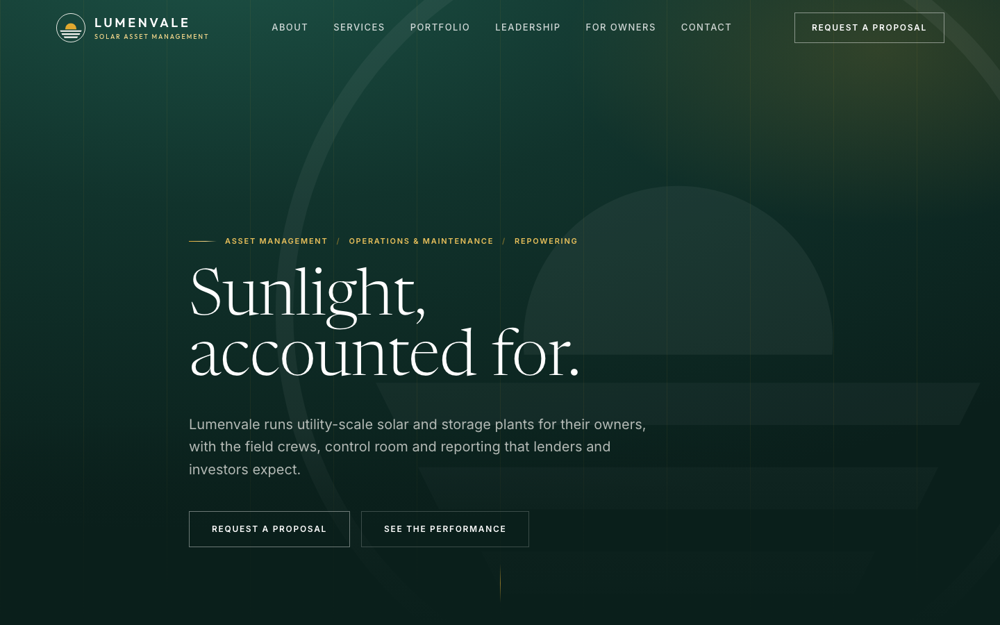
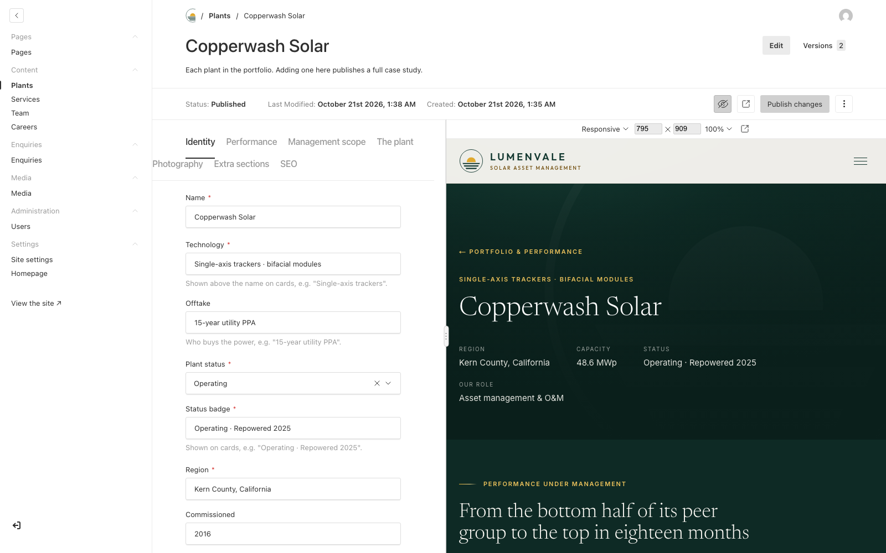
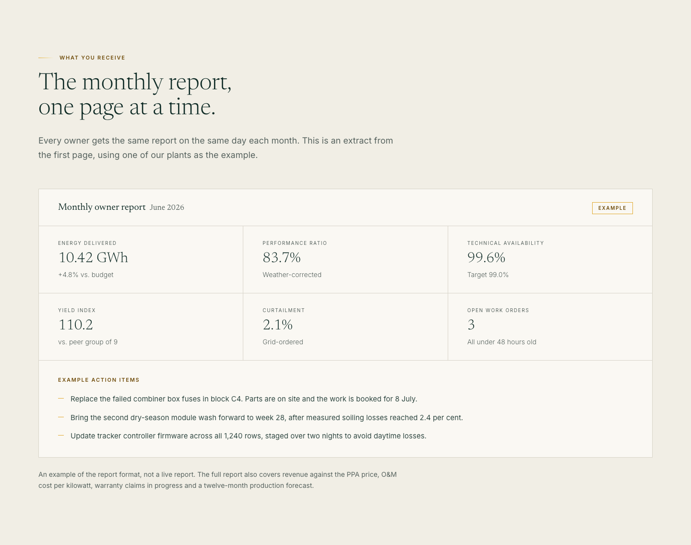

# Lumenvale

Corporate website and content management system for **Lumenvale Energy**, a company that runs
utility-scale solar and storage plants for their owners.

> Lumenvale is fictional. The company, its plants, people, figures and contact details are
> invented for this project, and every email address uses the reserved `.example` domain. The
> code is the real thing: a complete site with an editor-friendly CMS, built to be deployed.



## Highlights

- **One app, two layers.** A statically rendered Next.js site and the Payload admin at `/admin`
  share a single deployment. Publishing in the admin refreshes the affected pages within seconds
  through `revalidatePath`; nothing is rebuilt.
- **Page builder with guard rails.** Editors assemble pages from 14 section blocks (text, cards,
  process timelines, figures, FAQs, enquiry panels, long-form legal text and more). Each block picks
  a background from a fixed list of _surfaces_, and the surface decides the text colour, so no
  combination an editor can choose fails contrast or leaves the palette.
- **Live preview.** Drafts autosave while you type and the real page re-renders beside the form, at
  phone, tablet or desktop width. A draggable divider fixes Payload's hard-coded 40/60 split.
- **Case studies that lead with data.** Each plant page opens with performance: metric cards, a
  provenance line (period, source, peer group) and a monthly yield-index chart drawn in plain SVG,
  with the same numbers available as a table.
- **Enquiry forms done properly.** Server actions with validation, a honeypot, and values restored
  after a rejected submission. The record is saved before the notification email is attempted, so a
  mail outage never loses a lead. Optional attachments are emailed and never stored.
- **An admin for non-developers.** Branded sign-in, an orientation panel on the dashboard, labels in
  plain English, wireframe thumbnails in the block picker, automatic clean-up of abandoned drafts, and
  a first account that is always an administrator.
- **Launch safety.** `robots.txt` and the robots meta tag share one `ALLOW_INDEXING` switch and are
  closed by default; `PREVIEW_MODE` hides the admin and API on preview deploys.
- **Accessibility.** Built to WCAG 2.1 AA, with an axe-core audit script, full keyboard support and
  `prefers-reduced-motion` respected.

## Screenshots

| Case study: metrics and yield index | Admin: editing with live preview |
| --- | --- |
|  |  |



## Stack

| Layer   | Choice                                                     |
| ------- | ---------------------------------------------------------- |
| Front   | Next.js 16 (App Router), React 19, TypeScript, Tailwind CSS 4 |
| CMS     | Payload 3, embedded in the same Next app                   |
| DB      | PostgreSQL 17 (Docker locally, any managed Postgres in production) |
| Media   | Local disk in development, Vercel Blob when deployed       |
| Email   | Resend                                                     |
| Tests   | Vitest, Playwright, axe-core                               |

## Getting started

Requirements: Node 20+, Docker.

```bash
docker compose up -d     # Postgres on localhost:5434
cp .env.example .env     # then set PAYLOAD_SECRET, e.g. openssl rand -hex 24
npm install
npm run dev
```

In a second terminal, load the demo content:

```bash
npm run seed
```

- Site: http://localhost:3000
- Admin: http://localhost:3000/admin (the first account you create is an administrator)
- Brand sheet: http://localhost:3000/brand-kit (development only)

In development Payload pushes the schema to the database automatically. Production applies the
migrations in `src/migrations` instead (`npm run migrate`), so use a separate database for each.

## Scripts

| Command                        | What it does                                              |
| ------------------------------ | --------------------------------------------------------- |
| `npm run dev`                  | Development server                                        |
| `npm run build` / `npm start`  | Production build and server                               |
| `npm run seed`                 | Load the demo content; `-- --force` overwrites it         |
| `npm run migrate`              | Apply database migrations                                 |
| `npm run generate:types`       | Regenerate `src/payload-types.ts` after a schema change   |
| `npm run typecheck` / `lint`   | TypeScript and ESLint                                     |
| `npm run test:int`             | Unit and integration tests (Vitest)                       |
| `npm run test:e2e`             | End-to-end tests (Playwright, against the seeded site)    |
| `node scripts/a11y.mjs / /portfolio` | axe-core WCAG 2.1 AA audit; exits non-zero on failure |
| `node scripts/shots.mjs / .shots`    | Screenshots of every section at desktop and mobile widths |

Both scripts accept `SHOT_BASE_URL` to run against a production build or a preview deploy.

## Project structure

```
src/
  app/(frontend)/      public site, one directory per route
  app/(payload)/       Payload admin and REST/GraphQL endpoints
  actions/             server actions (enquiry forms)
  blocks/              section palette: block configs and their renderers
  collections/         Payload collections (plants, services, pages, enquiries...)
  globals/             site settings and homepage
  components/          brand marks, layout, homepage sections, case study, admin UI
  hooks/               preview URLs, autosave, revalidation, draft clean-up
  lib/                 CMS read layer, domain types, surfaces, attachment rules
  seed/                demo content
  migrations/          database migrations
tests/                 Vitest and Playwright suites
```

## How it fits together

**Content model.** Plants, services, team members, jobs and pages are collections; site settings and
the homepage are globals. Components never see raw Payload documents: `src/lib/cms.ts` maps them
onto the view types in `src/lib/types.ts`, so a schema change is absorbed in one place. The only
exception is page sections, which go straight to the block renderers in `src/blocks/Sections.tsx`.

**Drafts and preview.** Every previewable collection uses drafts with autosave. The live preview pane
loads `/next/preview`, which checks for an admin session and enables Next's draft mode; the read
layer then returns drafts instead of published documents. No page knows that preview exists.

**Revalidation.** Collection hooks in `src/hooks/revalidate.ts` clear the document's own page, the
indexes that list it and, where needed, the whole layout (a page that adds itself to the menu, or a
change to site settings). Autosaves are skipped, so typing does not throw the cache away.

**Surfaces.** `src/lib/surfaces.ts` lists the backgrounds an editor can choose. Each pairs a background
with the text tone that works on it, which is why the admin offers a list rather than a colour picker.

**Design tokens.** Colours are named by role (`primary`, `accent`) in `src/app/(frontend)/styles.css`,
so restyling the site is a change of values rather than a search and replace.

## Deployment

The project targets Vercel with a managed Postgres database. `vercel.json` runs the migrations before
each build. What the deployment needs that local development does not:

| Variable                        | Purpose                                                        |
| ------------------------------- | -------------------------------------------------------------- |
| `DATABASE_URL`                  | Managed Postgres (Neon, Supabase, RDS...)                      |
| `PAYLOAD_SECRET`                | Signs admin sessions; `openssl rand -hex 24`                   |
| `NEXT_PUBLIC_SITE_URL`          | The address that actually resolves; used in reset links        |
| `BLOB_READ_WRITE_TOKEN`         | Vercel Blob store for uploads (injected when a store is linked) |
| `RESEND_API_KEY`, `EMAIL_FROM`  | Password resets and enquiry notifications                      |
| `ALLOW_INDEXING`                | `1` on the live production deployment only                     |
| `PREVIEW_MODE`                  | `1` on preview deployments; hides `/admin` and `/api`          |

Without `RESEND_API_KEY`, Payload logs emails instead of sending them and still reports success, so
set it before anyone relies on password resets or enquiry notifications.

## License

[MIT](LICENSE)
